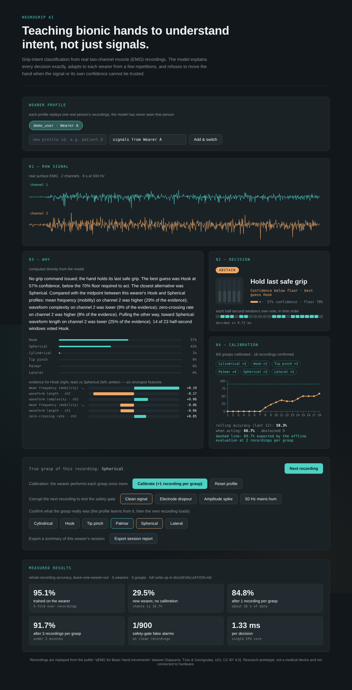
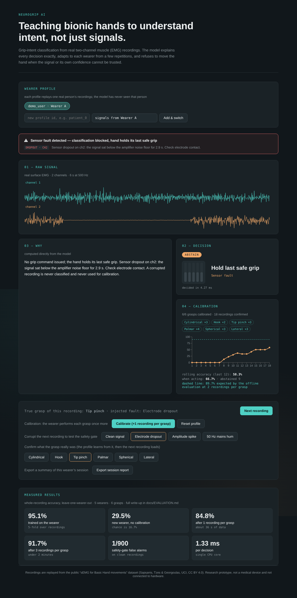

<div align="center">

# NeuroGrip AI

### Teaching bionic hands to understand *intent*, not just signals.

Grip-intent classification from real two-channel muscle (EMG) recordings: it explains every decision exactly, adapts to each wearer from a few repetitions, and refuses to move the hand when the signal or its own confidence cannot be trusted.

**Live demo: [neurogrip-ai.onrender.com](https://neurogrip-ai.onrender.com)** (free tier: the first load can take about a minute while it wakes)

[](https://github.com/NeerajGupta18/NeuroGrip-ai/actions/workflows/ci.yml)


</div>



## The finding this project is built around

A myoelectric hand reads the electrical activity of forearm muscles and has to decide which grasp the wearer intends. On real data, a model that works for the person it was trained on is almost useless on anyone else, and a few seconds of calibration fixes that.

| Situation | Accuracy (whole recording, 6 grasps, chance 16.7%) |
|---|---|
| Model trained on the wearer's own data | **95.1%** |
| Same model on a person it has never seen | **29.5%** |
| New wearer after 1 recording of each grasp (36 s of data) | **84.8%** |
| New wearer after 3 recordings of each grasp | **91.7%** |

Everything else in the repo follows from that: the model is chosen because it can be personalised from a handful of recordings, the agent refuses to act for a wearer who has not calibrated, and the dashboard shows the recovery happening live.

All numbers come from `backend/training/train.py` and are written up, with their limits, in [docs/EVALUATION.md](docs/EVALUATION.md).

## What it does

**1. Classifies real EMG.** Five people, six everyday grasps (cylindrical, hook, tip pinch, palmar, spherical, lateral), two surface electrodes at 500 Hz. Recordings are cut into 0.5 s windows and each window becomes 12 time-domain features.

**2. Uses a model small enough to reason about.** A Gaussian classifier with a shared covariance matrix (LDA), written in about 100 lines of NumPy in [`model.py`](backend/app/model.py). SVM, random forest and logistic regression were benchmarked on the same splits: they gain 3 to 6 points within a wearer and nothing on an unseen wearer. The bottleneck is the difference between people, not model capacity.

**3. Personalises from a few repetitions.** Only the per-grasp means are re-estimated for each wearer; the covariance learned from other people is kept. The evaluation shows why: other people's class means are a poor prior, but how the features co-vary transfers.

**4. Explains each decision exactly.** Because the classifier is linear, "grasp A rather than B" splits into one contribution per feature, and the contributions add up to the decision margin with nothing approximated. An optional LLM may re-word that evidence but never produces it.

**5. Knows when not to act.** The decision graph abstains, and the hand holds its last safe grip, when:

- a sensor fault is detected (electrode dropout, amplitude spike, 50 Hz mains hum),
- the wearer has not calibrated every grasp, or
- confidence is below a floor chosen from the measured accuracy/coverage trade-off.

Corrupted recordings are never learned from. The safety thresholds are measured from clean data, and raised 1 false alarm in 900 clean recordings from people not used to set them.



## How a decision is made

```
check_quality ──fault────────────────────────────────► abstain
      │ clean
      ▼
extract_features ─► classify ──not calibrated────────► abstain
                        │      or confidence < 70%
                        │ calibrated and confident
                        ▼
                    explain ─► grip command
```

```
backend/
├── app/
│   ├── features.py      windowing + 12 time-domain EMG features
│   ├── model.py         Gaussian classifier, personalisation, exact explanation
│   ├── anomaly.py       signal-quality gate (dropout / spike / hum)
│   ├── faults.py        synthetic fault injection for demos
│   ├── calibration.py   per-wearer profiles, test-then-train accuracy
│   ├── agent.py         LangGraph decision graph with abstain branches
│   ├── dataset.py       model artifacts + replayed recordings
│   ├── store.py         profile storage (Postgres or JSON files)
│   └── main.py          FastAPI routes
├── training/train.py    trains, evaluates, writes artifacts + docs/EVALUATION.md
├── tests/               maths, safety gate, storage, API end to end
└── data/recordings.npz  the recordings the dashboard replays
frontend/                React + Vite dashboard
docs/EVALUATION.md       every number, and what it does not show
Dockerfile, render.yaml  production image and Render Blueprint
```

## Run it

Backend:

```bash
cd backend
pip install -r requirements.txt
uvicorn app.main:app --port 8123        # API docs at http://127.0.0.1:8123/docs
```

Frontend:

```bash
cd frontend
npm install
cp .env.example .env
npm run dev                              # http://localhost:5173
```

Tests:

```bash
cd backend
pip install -r requirements-dev.txt
python -m pytest -q
```

Re-train from the raw data: download the dataset from <https://archive.ics.uci.edu/dataset/313>, unzip it, then

```bash
cd backend
python -m training.train --raw /path/to/unzipped --baselines
```

## Deploy

The repo ships a `Dockerfile` (builds the dashboard, then serves it from the API on one origin) and a Render Blueprint, `render.yaml`:

[](https://render.com/deploy?repo=https://github.com/NeerajGupta18/NeuroGrip-ai)

Or run the same image anywhere:

```bash
docker build -t neurogrip-ai .
docker run -p 10000:10000 neurogrip-ai      # http://localhost:10000
```

| Variable | Purpose |
|---|---|
| `DATABASE_URL` | Postgres connection string. Set it to keep wearer profiles across restarts; without it they are JSON files on local disk. |
| `ALLOWED_ORIGINS` | Comma-separated origins allowed to call the API cross-origin. Empty in the hosted build, where the dashboard and API share an origin. |
| `GROQ_API_KEY` | Optional. Lets an LLM re-word the computed explanations. |
| `MAX_PROFILES` | Cap on stored profiles (default 500); the oldest are dropped. |

CI runs the tests against both storage backends, builds the dashboard, builds the image and smoke-tests it on every push.

## Try this in the dashboard

1. A new profile is uncalibrated: the model is often confident and wrong, and the agent abstains.
2. Press **Calibrate** once or twice and step through recordings: decisions switch to ACT and the rolling accuracy climbs toward the dashed line the offline evaluation predicts.
3. Pick a fault and load the next recording: classification is blocked and the fault is named.
4. Add a profile that replays a different wearer: it starts from scratch, because one person's calibration does not carry over.

## API

| Endpoint | Method | Purpose |
|---|---|---|
| `/api/meta` | GET | Grasps, wearers, fault types, confidence floor |
| `/api/evaluation` | GET | The offline evaluation |
| `/api/users` | GET / POST | List or create wearer profiles |
| `/api/profile/{id}` | GET | Calibration state and accuracy history |
| `/api/profile/{id}/reset` | POST | Back to the uncalibrated model |
| `/api/signal/next` | POST | Next unseen real recording, optionally with an injected fault |
| `/api/predict` | POST | Run the decision graph on a two-channel recording |
| `/api/feedback` | POST | Confirm the true grasp; score, then learn |
| `/api/calibrate` | POST | Guided calibration, one recording per grasp |
| `/api/report/{id}` | GET | Session report |

`/api/predict` accepts any two-channel 500 Hz signal, so a real acquisition board could post to it directly.

## Limits

- Five healthy wearers, two electrodes, six grasps. No amputee data.
- Recordings are replayed, not streamed from hardware.
- Day-to-day drift is not solved: on a second dataset (one person, three days) accuracy falls from 78% to about 44% the next day, and recalibration only brings it back to about 70%.
- Sensor faults are synthetic.

## Data

*sEMG for Basic Hand movements*, C. Sapsanis, A. Tzes, G. Georgoulas (2013), UCI Machine Learning Repository, <https://doi.org/10.24432/C5TK53>, licensed CC BY 4.0. `backend/data/recordings.npz` is a re-encoded copy of Database 1.

<div align="center">
<sub>Built by Neeraj Gupta · Final-year B.Tech, AI & Data Science, MIT-WPU Pune</sub>
</div>
